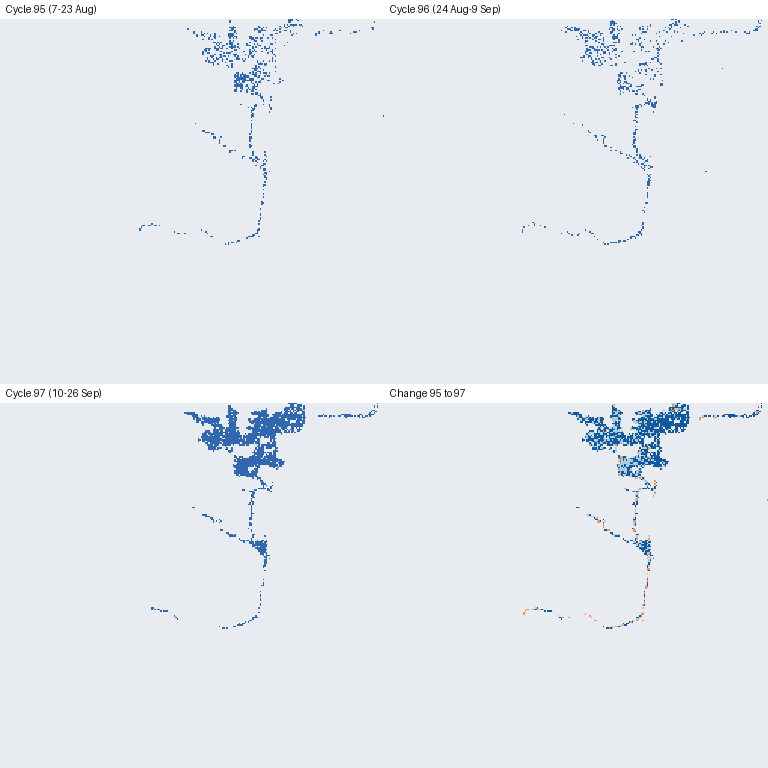

# EOS-04 Tiles over OGC WMTS and OGC API – Tiles

A standards-based tile service (**WMTS 1.0.0** and **OGC API – Tiles**) over ISRO EOS-04 SAR-derived products from
[Bhoonidhi](https://bhoonidhi.nrsc.gov.in), built on GeoServer + GeoWebCache.
Mid-Sem practical, CyberGIS (M26GS2.402).



*Nagarjuna Sagar reservoir (EOS-04 tile N16E079), Aug–Sep 2026. Top-left to bottom-right: water spread for cycles 95,
96 and 97, then the change layer (dark blue = water gained, orange = lost). Every panel is a tile fetched through WMTS.*

## Proposal vs delivered

| Proposal | Delivered |
|---|---|
| OGC WMTS 1.0.0 and OGC API – Tiles with GeoServer | Same: GeoServer + GeoWebCache + `ogcapi-tiles` module |
| EOS-04 water-spread tiles from Bhoonidhi | Real Bhoonidhi tiles: tile N16E079, three 17-day cycles in 2026 |
| COG conversion, mosaic, styled map tiles, tile cache | Same: `build_bhoonidhi_layers.py` + `publish.py`; class styles; cached tiles |
| `GetCapabilities`, `GetTile`, `GetFeatureInfo`; EPSG:3857 and EPSG:4326 | Same, plus the `EPSG:900913` alias; all tested |
| OGC API – Tiles `/collections` and tiles | Same; tiles live under `/collections/{id}/map/tiles/...` (raster layers are map tilesets) |
| (not in proposal) | Derived water-change layer, read-only gateway, 28 live tests |

## 1. Gap identified

| Today | Missing |
|---|---|
| Portal: cart + whole-file download | A tile endpoint QGIS / a web map can load |
| API: STAC search + `GET /download`, login, rate limits | Any WMTS / OGC API – Tiles / WCS / WFS on open products |
| Vista viewer: browsing inside the portal | A public, documented, cacheable standards endpoint |

- EOS-04 products are **1°×1° GeoTIFF tiles** (6112 × 6112 px, ~18 m) delivered as zips containing a GeoTIFF, a `.meta`
  file and a JPEG preview. The water-spread zips are small (0.2–0.5 MB; 9.4 MB unzipped), so for water spread the gap is
  **interoperability, not size**: no endpoint a map or QGIS can load; the user must unzip, read the `.meta` to learn the
  coding (0 land, 2 water, 3 background), georeference, mosaic and style it, once per date. The backscatter mosaics are
  large (100 MB+ per zip) and make the size argument as well.
- Measured: the same Nagarjuna Sagar area for all three dates is **17 KB of tiles at zoom 10** (45 KB at zoom 11)
  versus ~1 MB of zips plus local processing ([docs/GAP.md](docs/GAP.md#measured)).
- The Bhoonidhi API is STAC discovery + download, with no OGC data service
  ([API docs](https://bhoonidhi.nrsc.gov.in/bhoonidhi-api/)).
- **Counter-evidence, stated openly:** Vista's own scripts load imagery as WMS, with layer URLs returned by an
  authenticated backend (`POST /vista/Vista`). So an *internal* WMS exists; what is missing is a **public, documented,
  cacheable WMTS / OGC API – Tiles**.
- Bhuvan: ~8,900 WMS layers checked, **0** SAR/EOS layers; its WMTS `GetCapabilities` returned HTTP 400 on 2026-10-11.

Dated evidence and what is **not verified** (Vista WMS URLs without a token): [docs/GAP.md](docs/GAP.md).

## 2. Service design

```
Bhoonidhi EOS-04 zips --build_bhoonidhi_layers.py--> COGs (data/cogs) + layers.json
        COGs --publish.py (REST)--> GeoServer --> WMS (source)
                                             |--> GeoWebCache --> WMTS 1.0.0
                                             '--> ogcapi-tiles --> OGC API - Tiles
        nginx gateway :8081 (read-only: WMTS / tiles / WMS / demo page only)
```

| Layer (`bhoonidhi:`) | Content | Style |
|---|---|---|
| `ws_c95`, `ws_c96`, `ws_c97` | EOS-04 water spread, cycles 95 / 96 / 97 (0 land, 2 water, 3 background) | transparent land, blue water |
| `wschange_c95_c97` | derived: 1 stable water, 2 gained, 3 lost | light blue / dark blue / orange |

Layers are declared in [layers.json](layers.json) (generated by the build script).

**Implemented operations** (all covered by `tests/test_ogc.py`, **28 passing**)

- **WMTS 1.0.0:** `GetCapabilities`, `GetTile` (KVP and RESTful), `GetFeatureInfo` (returns the class value);
  tile matrix sets `EPSG:3857`, `EPSG:900913` (legacy alias) and `EPSG:4326`; `image/png`, `image/jpeg`;
  OGC exception reports on bad requests.
- **OGC API – Tiles** (GeoServer community module): landing page, `/conformance`, `/collections`,
  `/collections/{id}/map/tiles` (raster layers are *map* tilesets), `/tileMatrixSets`,
  `/collections/{id}/map/tiles/{tmsId}/{tileMatrix}/{row}/{col}`.
- **WMS 1.1.1/1.3.0** `GetMap` on the source layers (GeoServer built-in).

## 3. Implementation choices

- **GeoServer + GeoWebCache:** reference WMTS and tile caching; SLD styling.
- **COG inputs:** internal tiling and overviews; nearest-neighbour resampling keeps class values intact.
- **Docker Compose:** one command; the `ogcapi-tiles` community module installs at start-up.
- **Idempotent REST publishing:** `publish.py` recreates stores so bounds and CRS follow the data, and removes
  layers that are no longer in `layers.json`.
- **Read-only gateway (nginx):** admin UI, REST and GWC REST are never exposed; only GET/HEAD on tile/WMS paths.

## 4. Run it

```bash
pip install -r requirements.txt
# put the Bhoonidhi EOS-04 zips (E04_SAR_MRS_..._J1G0WSHTD.zip etc.) in data/bhoonidhi/
python scripts/build_bhoonidhi_layers.py      # unzips, writes data/cogs/*.tif and layers.json
docker compose up -d                           # GeoServer :8080 (first start installs extensions), gateway :8081
python scripts/publish.py                      # styles, layers, EPSG:3857 gridset, tile cache
GATEWAY_URL=http://localhost:8081 pytest -v tests
```

Then open `http://localhost:8081/demo/` or, in QGIS, add a WMTS connection to
`http://localhost:8081/geoserver/gwc/service/wmts?REQUEST=GetCapabilities`.

```bash
B=http://localhost:8081/geoserver
curl "$B/gwc/service/wmts?service=WMTS&request=GetCapabilities&version=1.0.0"
curl -o tile.png "$B/gwc/service/wmts?service=WMTS&request=GetTile&version=1.0.0&layer=bhoonidhi:wschange_c95_c97&style=&format=image/png&tilematrixset=EPSG:3857&tilematrix=EPSG:3857:10&tilerow=464&tilecol=737"
# GetFeatureInfo: a point (79.179 E, 16.546 N) that is land in cycle 95 and water in cycle 97 returns GRAY_INDEX 2 on ws_c97
curl "$B/gwc/service/wmts?service=WMTS&request=GetFeatureInfo&version=1.0.0&layer=bhoonidhi:ws_c97&style=&format=image/png&infoformat=application/json&tilematrixset=EPSG:3857&tilematrix=EPSG:3857:14&tilerow=7428&tilecol=11795&i=67&j=135"
curl "$B/ogc/tiles/v1/collections?f=application/json"
curl -o t2.png "$B/ogc/tiles/v1/collections/bhoonidhi:ws_c97/map/tiles/EPSG:900913/EPSG:900913:10/464/737?f=image/png"
```

Evidence and analysis: [docs/GAP.md](docs/GAP.md) (gap, measured bytes), [docs/COMPLIANCE.md](docs/COMPLIANCE.md) (standards checks;
`scripts/validate_wmts_schema.py`, `scripts/measure_tiles.py`). Demo script: [docs/DEMO.md](docs/DEMO.md).

## 5. Data

Downloaded from Bhoonidhi (free registration) through the cart: EOS-04 SAR MRS 1°×1° tile **N16E079**, product
`J1G0WSHTD` (L3 water spread), cycles 95, 96, 97 (7 Aug – 26 Sep 2026). Raw zips are not committed (size and
data terms); each zip contains `.tif`, `.meta` (processing metadata) and a `.jpg` preview. See
[docs/GAP.md](docs/GAP.md) for the product table.

## 6. Known limitations

- Only the water-spread product is served so far; the EOS-04 MRS backscatter mosaic (`FIGC00ZTD`) is not yet published. (The proposal named the ScanSAR NRB India mosaic; the downloaded backscatter product is the MRS 1° mosaic.)
- One 1° tile, three dates; no time dimension (cycles are separate layers).
- OGC API – Tiles in GeoServer is a **community module** (nightly builds); behaviour can change between releases.
- Raster only; values only through `GetFeatureInfo`. The SAR water mask is speckled, so single pixels flip between
  water and land; tests therefore check neighbourhood fractions.
- The first request at a new zoom renders on demand (cache not pre-seeded).
- Behind an HTTPS tunnel, GeoServer-generated OGC API links may use `http://`; WMTS URLs are unaffected.
- Whether Vista's WMS works without login is not verified (needs a browser).
